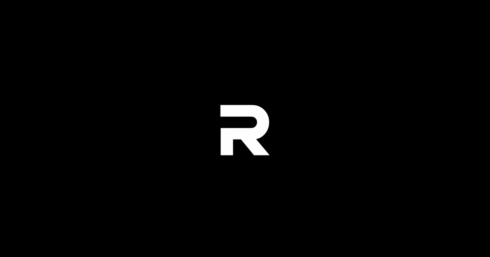
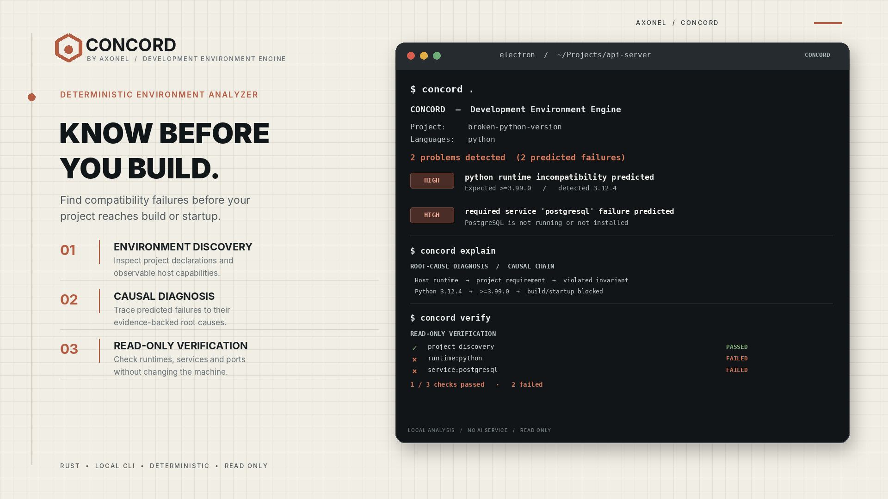
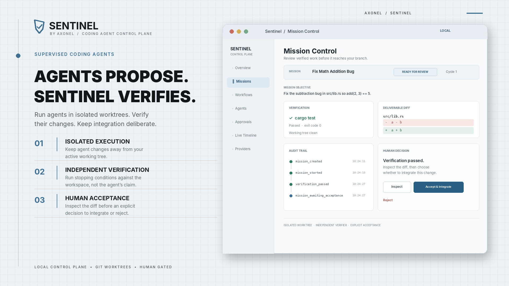
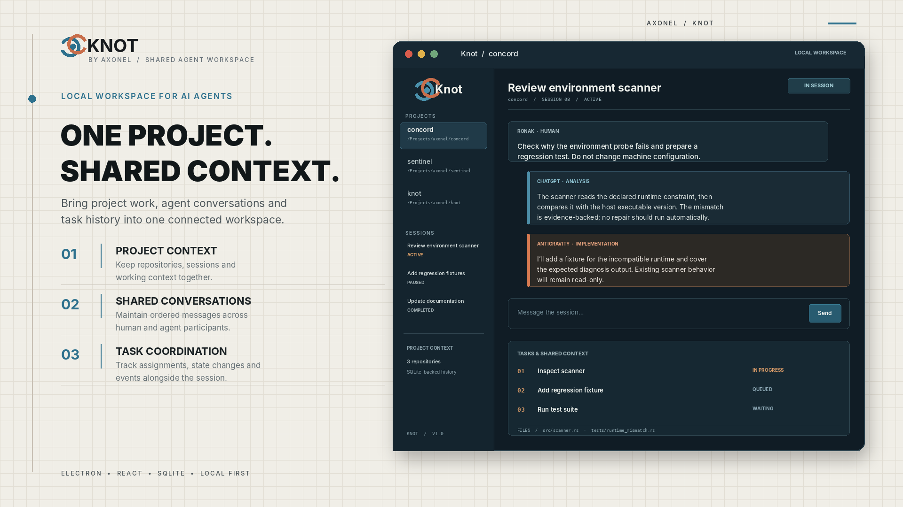
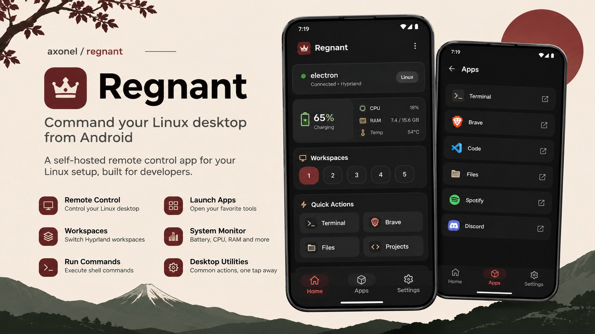

# RONAK YADAV — Portfolio

<div align="center">

[](https://ronakyadav-v1.netlify.app)
[](https://ronakyadav-v1.netlify.app/ronak-yadav-resume.pdf)
[](https://github.com/roonakyadav)
[](https://www.linkedin.com/in/ronak-yadav-330a0937a/)

<p align="center">
  <strong>Systems & Software Engineer</strong> · Low-Latency Infrastructure, Distributed Systems & Interactive Experiences
</p>



</div>

---

## ⚡ Overview

A high-performance personal portfolio built with **React 18**, **TypeScript**, and **Vite**. The design couples an editorial typography system with hardware-accelerated animations, WebGL shaders, and smooth kinetic interactions. 

### Key Highlights

- **70+ Upstream Merged PRs** — Active contributor across open-source systems, developer tooling, and infrastructure codebases.
- **1,000+ GitHub Contributions** in the past year alone.
- **Ritik Shah Inspired GSAP Intro Loader** — Cinematic entrance sequence featuring countdown progression, greeting cycle, and custom SVG curved page-cut reveal.
- **Aitezaz Editorial Projects Showcase** — Minimalist editorial layout featuring clean horizontal project rows, sequential counters, hover-revealed preview thumbnails, and burnt terracotta accents (`#C8755A`).
- **Interactive WebGL & Canvas Effects** — Fluid cursor simulations, dynamic contour maps, and interactive mesh shaders.
- **Kinetic Action Bar** — Viewport-centered pill action bar linking to contact channels, GitHub, and the live resume PDF.
- **Smooth Inertial Scrolling** — Optimized Lenis-powered scrolling paired with GSAP timeline triggers.

---

## 🛠️ Featured Systems & Projects

| Project | Description | Preview |
| :--- | :--- | :---: |
| **CONCORD** | High-performance protocol orchestrator and real-time state synchronizer engineered for low-latency multi-client distributed systems. |  |
| **SENTINEL** | Distributed telemetry daemon and kernel trace analyzer providing high-frequency system observability and anomaly triage. |  |
| **KNOT** | Resilient, low-latency async message broker designed for high-concurrency event-driven microservice architectures. |  |
| **REGNANT** | Low-level desktop environment management and hardware telemetry interface built for customized Linux distributions. |  |

---

## 💻 Tech Stack

| Domain | Technologies |
| :--- | :--- |
| **Core Framework** | React 18, TypeScript 5.8, Vite 6 |
| **Styling & Design System** | Tailwind CSS 3.4, shadcn/ui, Radix UI primitives |
| **Animation & Motion** | GSAP 3.13, Framer Motion 12 |
| **3D & Creative Shaders** | Three.js, OGL (WebGL) |
| **Smooth Scrolling** | Lenis, React Lenis |
| **Form Handling & Validation**| React Hook Form, Zod |
| **Testing & Quality** | Vitest, Testing Library (React & Jest DOM), ESLint |

---

## 📂 Project Architecture

```text
portfolio/
├── public/
│   ├── ronak-yadav-resume.pdf        # Canonical resume PDF
│   ├── preview.png                   # OpenGraph social preview card (1200x630)
│   ├── favicon.svg                   # Monochromatic geometric 'R' favicon
│   ├── concord_portfolio_visual.png  # Project visual assets
│   ├── sentinel_portfolio_visual.png
│   ├── knot_portfolio_visual.png
│   └── regnant_portfolio_visual.png
├── src/
│   ├── components/                   # Interactive UI widgets & visual effects
│   │   ├── ActionButtons.tsx         # Pill action bar (Resume, GitHub, Contact)
│   │   ├── PillActions.tsx           # Kinetic hover pill component with GSAP
│   │   ├── SignalLoader.tsx          # Curved-cut cinematic intro loader
│   │   ├── TopographyBackground.tsx  # Generative topographic background
│   │   ├── FluidCursor.tsx           # WebGL interactive fluid simulation
│   │   └── ui/                       # Accessible shadcn / Radix primitives
│   ├── data/
│   │   ├── profile.ts                # Profile identity, stats & bio
│   │   └── projects.ts               # Curated project metadata
│   ├── pages/
│   │   ├── Index.tsx                 # Main portfolio page entrypoint
│   │   └── MagicBento.tsx            # Selected works & engineering showcase
│   └── test/                         # Unit & integration test suite
```

---

## 🚀 Getting Started

### Prerequisites

- **Node.js**: `18.x` or higher
- **Package Manager**: `npm`, `pnpm`, or `bun`

### Installation

```bash
git clone https://github.com/roonakyadav/portfolio.git
cd portfolio
npm install
```

### Development Server

```bash
npm run dev
```

Runs the local development server at `http://localhost:8080/`.

### Run Unit Tests

```bash
npm run test
```

Executes the Vitest test suite covering profile statistics, form validations, and action buttons.

### Production Build

```bash
npm run build
```

Generates optimized, production-ready static assets in `dist/`, including `dist/ronak-yadav-resume.pdf`.

---

## 📄 Resume

The latest resume is served natively at:
- Local / Staged: [`public/ronak-yadav-resume.pdf`](public/ronak-yadav-resume.pdf)
- Production: [https://ronakyadav-v1.netlify.app/ronak-yadav-resume.pdf](https://ronakyadav-v1.netlify.app/ronak-yadav-resume.pdf)

---

## 📬 Contact & Channels

- **Email:** [ronakyadav1609@gmail.com](mailto:ronakyadav1609@gmail.com)
- **GitHub:** [@roonakyadav](https://github.com/roonakyadav)
- **LinkedIn:** [Ronak Yadav](https://www.linkedin.com/in/ronak-yadav-330a0937a/)
- **Instagram:** [@roonakyadav_](https://www.instagram.com/roonakyadav_/)

---

<p align="center">
  MADE BY RONAK ® 2026
</p>
